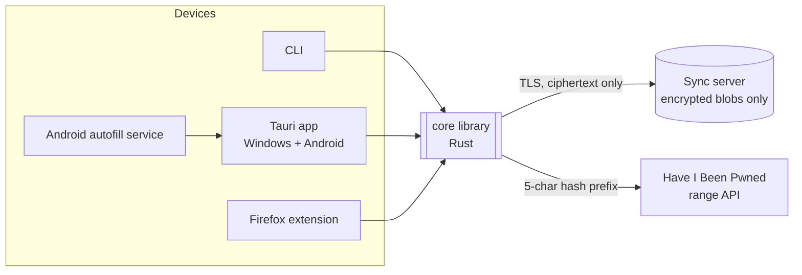

# Architecture

This document describes the intended design. Nothing here is implemented yet.
Items marked **Open** are not decided; see [Open decisions](#open-decisions).

## Overview



The rule that shapes everything: **all encryption and decryption happens on the
device, inside the core library.** The server stores and forwards ciphertext.
It never receives the master password, any key that can decrypt a vault, or any
plaintext item.

## Components

### `crates/core` (Rust library)

The only place that touches secrets. Every client uses it, so the security
logic exists once.

- Key derivation, encryption, key hierarchy (see [security.md](security.md))
- Data model: accounts, vaults, logins, tags
- Password generator
- TOTP: parsing `otpauth://` URIs, decoding a QR image, generating codes
- Breach check client
- Backup export and import format
- Local encrypted storage
- Sync client logic

### `crates/cli`

A thin command-line program over the core. It is the first client because it
lets the core be exercised without any UI or network code. It stays useful
afterwards for scripting and testing.

### `crates/server`

A Rust HTTP server, shipped as a Docker image.

- Registration and login for a small number of accounts
- Stores encrypted vault data and encrypted key material per account
- Sync endpoints (push and pull of encrypted changes)
- Device list per account
- Server-side backups of the (already encrypted) database
- Rate limiting and lockout on authentication endpoints

Because the hosting location is undecided, the server is designed to be safe on
a public VPS: TLS is required and hardening is built in rather than left to a
VPN.

### `apps/app` (Tauri 2)

One application for Windows and Android.

- Backend: Rust, calling `crates/core` directly
- Frontend: React + TypeScript, built with Vite
- The frontend never holds key material; it asks the Rust side for what it
  needs to display

### `apps/extension` (Firefox)

Targets Firefox desktop and Firefox for Android.

- Content script: detects login and registration forms, offers autofill and
  offers to save new logins
- Popup: search and copy, built with the same React components as the app where
  practical

### Android autofill service

Android's system autofill (used by Chrome and by other apps) requires a native
service written in Kotlin. It lives inside the Tauri Android project and calls
into the Rust core.

## Technology choices

| Area | Choice | Reason |
|---|---|---|
| Language | Rust | Memory safety; one core shared by all clients; learning goal |
| App shell | Tauri 2 | One codebase for Windows and Android with a Rust backend |
| Frontend | React + TypeScript on Vite | Already known; Vite is Tauri's default build tool |
| Extension target | Firefox | Runs on desktop and Android |
| Breach check | Have I Been Pwned range API | Only a 5-character hash prefix leaves the device |
| Repository | One public monorepo, Cargo workspace | Components change together |

Specific crates (HTTP framework, database, crypto implementations) are chosen
at the start of the milestone that needs them and recorded here.

## Planned repository layout

```
password-manager/
├── crates/
│   ├── core/
│   ├── cli/
│   └── server/
├── apps/
│   ├── app/          Tauri 2 + React
│   └── extension/    Firefox extension
├── docs/
├── Cargo.toml        workspace manifest (added in milestone 0)
└── README.md
```

## Open decisions

Each of these is decided at the milestone noted, not before.

| Decision | Options | Decide at |
|---|---|---|
| Local storage | SQLite with encrypted fields; a single encrypted file | Milestone 2 |
| How the extension reaches the vault | Core compiled to WebAssembly inside the extension; native messaging to the desktop app | Milestone 8 |
| Login protocol | OPAQUE; a separate key derived from the master password | Milestone 5 |
| Sync conflict handling | Last write wins per item; per-field merge | Milestone 5 |
| Server database | SQLite; PostgreSQL | Milestone 5 |
| Server hosting | Home behind a VPN; public VPS | Deployment |
| Biometric unlock | Windows Hello, Android biometrics | Milestones 6 and 7 |
