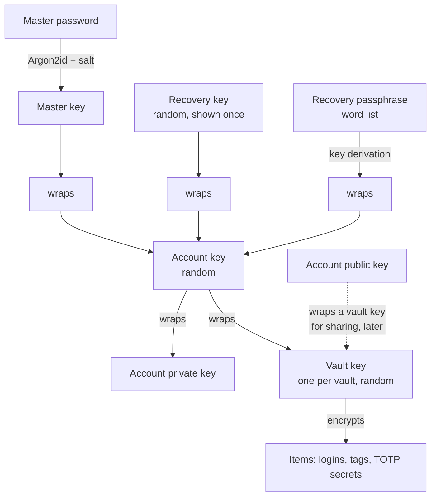

# Security design

This document describes the intended design. Nothing here is implemented or
audited yet. Items marked **Open** are not decided.

## Principles

1. **Zero knowledge.** The server never sees the master password, a decryption
   key, or plaintext vault data.
2. **No home-made cryptography.** We combine well-known algorithms from audited
   Rust crates. We never implement a cipher, hash or key-exchange ourselves.
3. **One place for secrets.** Only `crates/core` handles keys and plaintext.
4. **Secure by default.** Safe settings need no configuration; unsafe ones
   (for example plain HTTP) are not offered.
5. **The design is public.** Security must not depend on anyone not knowing how
   it works. The repository is open for that reason.

## Threat model

### What we defend against

| Threat | Defence |
|---|---|
| Someone reads network traffic | TLS on every connection, and the payload is already encrypted on the device |
| The server or its database is stolen or compromised | Server holds only ciphertext and wrapped keys; a slow key-derivation function protects the master password against guessing |
| A device is lost or stolen while locked | Vault is encrypted at rest; keys exist in memory only while unlocked |
| Online password guessing against the server | Rate limiting and lockout on authentication endpoints |
| A malicious web page tries to get credentials autofilled | Autofill matches the exact site origin and requires a user action; no filling into hidden or cross-origin frames |
| A vulnerable or malicious dependency | Minimal dependencies, `cargo audit` and `cargo deny` in CI, lockfile committed |
| Secrets left behind in memory, clipboard or logs | Keys wiped from memory after use, auto-lock, clipboard cleared after a timeout, secrets never logged |
| Forgotten master password | Recovery key and recovery passphrase (see below) |

### What we do not defend against

- **Malware on an unlocked device.** If an attacker controls the operating
  system while the vault is unlocked, they can read what the user can read.
- **A weak master password combined with a stolen database.** The
  key-derivation function slows guessing; it cannot make a weak password strong.
- **Loss of the master password and every recovery method.** By design, nobody
  can recover the data, including the server operator.
- **A user who is tricked into typing the master password into a fake app.**

## Key hierarchy

"Wraps" means "encrypts another key".

- The **master key** is derived from the master password and is never stored
  or sent anywhere.
- The **account key** is random. It is stored three times, each copy encrypted
  with a different key: the master key, the recovery key, and a key derived
  from the recovery passphrase. Any one of the three unlocks the account.
- Changing the master password only re-encrypts the account key. Vault data is
  untouched.
- Each account has a **public/private key pair**. It is unused at first. It
  exists so that a vault key can later be encrypted for another account, which
  is how shared vaults will work without changing the data format.
- Each **vault** has its own random key, which encrypts the items in it.

## Cryptographic choices

| Purpose | Algorithm |
|---|---|
| Master password to key | Argon2id, with a per-account random salt |
| Symmetric encryption | XChaCha20-Poly1305 (authenticated encryption, random nonces) |
| Account key pair | X25519 |
| Deriving sub-keys | HKDF-SHA-256 |
| Random numbers | The operating system's secure random generator |
| TOTP | RFC 6238 (HMAC-SHA-1 by default, as authenticator apps use) |
| Breach check | SHA-1 prefix lookup against the Have I Been Pwned range API |

Argon2id parameters (memory, iterations) are chosen in milestone 1 by measuring
on the slowest target device (Android), and are stored with the account so they
can be raised later.

Every encrypted value carries a version number so algorithms can be replaced
without breaking old data.

## Authentication to the server

The master password is never sent to the server, not even hashed in a way the
server could use to decrypt anything.

**Open:** the exact login protocol. The two candidates are OPAQUE (the server
never receives anything password-equivalent) and deriving a separate
authentication key from the master password. Decided in milestone 5.

Sessions are per device and can be revoked from the device list.

## Recovery

| Method | What it is | Where the user keeps it |
|---|---|---|
| Recovery key | A long random key shown once at account creation | Printed or stored offline |
| Recovery passphrase | A sequence of words from a standard word list | Written down |
| Encrypted backup | An export file of the vault, encrypted with a key the user chooses | Any storage |

Recovery methods are as powerful as the master password and must be protected
the same way.

## Client hardening

- Auto-lock after inactivity and on device lock
- Clipboard cleared a short time after copying a secret
- Secrets wiped from memory when no longer needed
- No secrets in logs, error messages or crash reports
- The app frontend (React) receives only what it must display; keys stay on the
  Rust side
- The extension fills only on a user action and only when the page origin
  matches the saved login

## Server hardening

- TLS required; no plain HTTP mode
- Rate limiting and lockout on registration and login
- Runs as an unprivileged user in a container
- Registration can be closed or invite-only, since the server is for a small
  known group

## Supply chain

- Dependencies kept to a minimum and reviewed before being added
- `Cargo.lock` and the frontend lockfile are committed
- CI runs `cargo audit` (known vulnerabilities) and `cargo deny` (licences,
  sources, duplicates) on every pull request

## Status

This design has not been reviewed by a security professional. Until it has,
the software should be treated as experimental.
